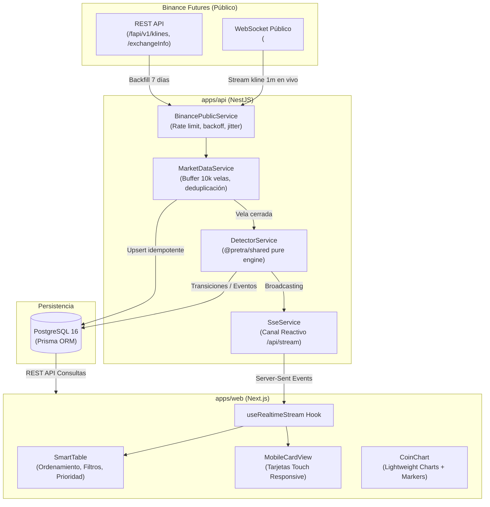
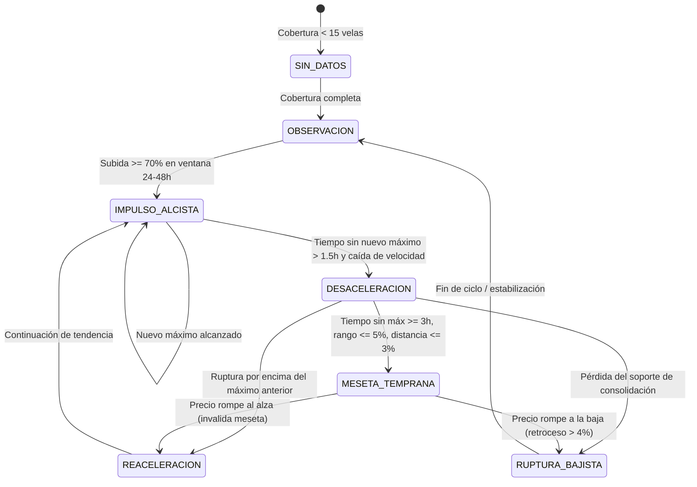

# Arquitectura Técnica - Futures Momentum & Early Plateau Monitor

## 1. Visión General del Sistema

El sistema implementa una arquitectura desacoplada y orientada a eventos para procesar series temporales de alta frecuencia (velas de 1 minuto) procedentes del mercado público de Binance Futures USDⓈ-M.

---

## 2. Máquina de Estados del Detector de Mesetas

El detector evalúa cada moneda ante cada vela cerrada de 1 minuto siguiendo un autómata determinista:

---

## 3. Formulación Matemática de Indicadores

### 3.1. Retornos Compuestos Multiplicativos
A diferencia de enfoques aditivos erróneos, los retornos se calculan mediante la tasa geométrica real:

$$\text{changePct} = \left( \frac{P_{\text{current}}}{P_{\text{ref}}} - 1 \right) \times 100$$

### 3.2. Distancia al Máximo Observado
Mide la proximidad relativa de la cotización respecto al techo alcanzado en la ventana rodante:

$$\text{distanceToPeakPct} = \left( \frac{P_{\text{current}}}{P_{\text{peak}}} - 1 \right) \times 100 \le 0$$

### 3.3. Rango de Consolidación de Meseta
Evalúa la amplitud de la banda de oscilación reciente:

$$\text{recentRangePct} = \left( \frac{\text{maxHigh} - \text{minLow}}{\text{minLow}} \right) \times 100$$

### 3.4. Velocidad y Retorno por Vela
* **Velocidad observada:** $\text{pctPerMinute} = \frac{\Delta \%}{N \text{ minutos}}$
* **Retorno compuesto por vela (tasa geométrica constante):**

$$r_{\text{vela}} = \left[ \left( \frac{P_t}{P_0} \right)^{\frac{1}{N}} - 1 \right] \times 100$$

---

## 4. Estrategia de Ingesta y Resiliencia en Binance

1. **Sin credenciales:** Exclusivamente endpoints públicos de Binance Futures USDⓈ-M.
2. **Paginación y Rate Limiting:** En el backfill inicial de 7 días, se descargan hasta 1,500 velas por petición con pausas de cortesía y backoff exponencial con jitter ante códigos HTTP 429.
3. **Reconexión Automática WebSocket:** Heartbeat ping/pong cada 180 segundos. Si el stream se interrumpe, se reconecta automáticamente y se re-suscriben los símbolos activos sin pérdida de estado.
4. **Idempotencia:** La clave compuesta `(symbol, interval, openTime)` en PostgreSQL garantiza que ninguna vela se inserte dos veces.
